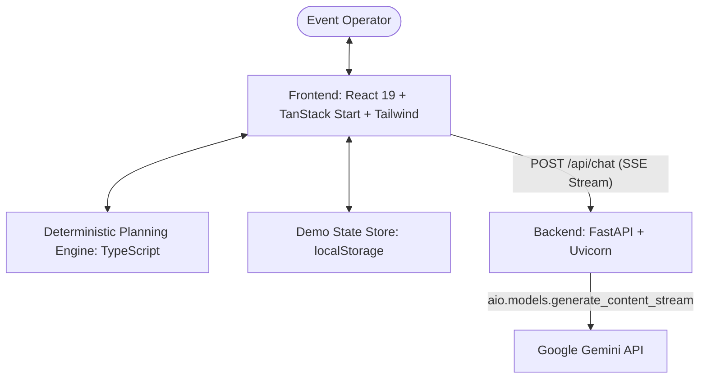

# Planzo — Intelligent Event Contingency & Recovery Assistant

> **When plans change, move smarter.**  
> An intelligent event operations assistant developed for the **Amazon Developer Hackathon 2026 (Alexa+ Simulated Experience Track)**.

Planzo coordinates event disruption response by pairing conversational AI with a deterministic contingency planning engine. When weather or logistical threats arise, Planzo evaluates real-time venue constraints, explains grounded alternatives via an Alexa+-inspired voice and chat simulation, and prepares communication drafts once a human operator explicitly authorizes a move.

---

## 1. What Planzo Is

Planzo is an event operations cockpit that automates contingency evaluation while enforcing human-in-the-loop authorization. When an outdoor event faces imminent weather disruption, Planzo eliminates the frantic scramble across spreadsheets and campus calendars:

- **Sense:** Detects disruption risks (e.g. simulated heavy rain over outdoor venues).
- **Decide:** Deterministically evaluates all alternative campus venues against capacity, equipment, and conflicting bookings to propose the single best relocation.
- **Act (Advisory):** Explains trade-offs via a Gemini-powered conversational assistant (simulating an Alexa+ agentic experience).
- **Authorize & Recover:** A human operator must explicitly click **Approve**. Once authorized, Planzo swaps the bookings, updates the event status to handled, and drafts a ready-to-copy attendee announcement.

---

## 2. The Problem It Solves

Event organizers face high-stress, time-sensitive decisions when disruptions occur:
- **Scattered Information:** Finding an open indoor venue requires cross-referencing room schedules, seat capacities, and audiovisual inventories.
- **AI Hallucination Risks:** Generic AI agents cannot safely book facilities; unconstrained models might promise a conference room that is already booked or too small.
- **Communication Delays:** Relocating an event requires immediately drafting accurate announcements with exact room names and instructions for attendees.

Planzo solves this by strictly separating **reasoning** from **execution**. The deterministic engine guarantees physical truth, while the conversational AI provides intuitive natural-language explanations.

---

## 3. How the Alexa+-Inspired Simulation Works

Planzo simulates an agentic, multi-modal **Alexa+ voice assistant experience** directly inside the operational dashboard:

1. **Voice Query Normalization:** Strips voice prefixes like *"Alexa, ask Planzo to find a safer venue"* and maps them to structured intents (`check_risk`, `find_alternative`, `show_plan`, `approve_guidance`).
2. **Context Grounding:** The frontend packages the live event state (current venue, attendees, equipment needs, candidate venues, and deterministic proposals) and sends it with every query.
3. **SSE Streaming:** FastAPI streams tokens via Server-Sent Events from Google Gemini (`gemini-3.5-flash-lite` / `gemini-3.8-flash`), displaying responses in real time with dynamic streaming cursors.
4. **Speech Synthesis:** Optional browser text-to-speech reads responses aloud, reproducing a hands-free smart-display or voice-assistant experience.
5. **Safety Guardrail:** Natural-language requests to approve (e.g. *"Alexa, approve this change"*) are deliberately intercepted with safety guidance explaining that operational bookings require human authorization.

> *Disclaimer: Planzo is an independent concept prototype built for the Amazon Developer Hackathon 2026 and is not an Amazon-affiliated product or production Alexa skill.*

---

## 4. Architecture & Technology Stack



- **Frontend:** React 19, TypeScript, TanStack Start & Router, Vite, Tailwind CSS, Lucide icons, Sonner toasts.
- **Backend:** Python 3.11, FastAPI, Uvicorn, Google GenAI SDK (`google-genai`), Pydantic v2.
- **Deterministic Planning:** Written in pure TypeScript with zero external planning dependencies.
- **Storage:** Client-side `localStorage` with authoritative demo seed data and instant reset capability.

---

## 5. What Gemini Does vs. What Deterministic Logic Does

| Feature | Handled By | Responsibility |
| :--- | :--- | :--- |
| **Conversational Interaction** | **Google Gemini** | Natural language comprehension, Alexa+ persona, grounded risk explanations, streaming SSE. |
| **Grounded Reasoning** | **Google Gemini** | Explaining why a venue was chosen or excluded using structured evidence supplied in prompt context. |
| **Venue Eligibility** | **Deterministic Logic** | Checking indoor suitability, seat capacity ($\ge$ attendees), required equipment, and time slot conflicts. |
| **Proposal Selection** | **Deterministic Logic** | Selecting the smallest eligible venue that satisfies all requirements (least wasted capacity). |
| **Booking Reassignment** | **Deterministic Logic** | Mutating bookings and event venue assignments only upon explicit human button click. |
| **Offline Fallback** | **Deterministic Logic** | Seamlessly generating pre-computed advisory replies if the backend or internet is unreachable. |

---

## 6. How Approval & Post-Approval Recovery Work

1. **Human Authorization:** Proposals can only be confirmed by clicking the green **Approve** button in the Decision Studio. Conversational approval attempts are politely refused.
2. **Atomic State Update:** On approval, the event's venue changes to the new room, the previous booking slot is released, the new room is reserved, and the risk status is marked as `handled`.
3. **Attendee Communication Draft:** Planzo automatically drafts an announcement with the exact event name, previous venue, new venue, unchanged time window, and contingency reason.
4. **Clipboard Copy:** A single click copies the formatted draft with visual toast confirmation.
5. **Audit Trail:** Every decision (approved or rejected) is permanently appended to the chronological **Activity** log.

---

## 7. Windows Setup & Reproduction Guide

### Prerequisites
- Node.js 20+ and npm
- Python 3.11+
- Google Gemini API key ([Google AI Studio](https://aistudio.google.com/))

### 1. Clone & Enter Repository
```powershell
cd D:\planzo-ai
```

### 2. Configure Backend
```powershell
cd D:\planzo-ai\Backend

# Create and activate virtual environment
python -m venv .venv
.\.venv\Scripts\Activate.ps1

# Install Python dependencies
pip install -r requirements.txt

# Create environment file
Copy-Item .env.example .env
```

Edit `Backend/.env`:
```env
GEMINI_API_KEY=your_gemini_api_key_here
GEMINI_MODEL=gemini-3.5-flash-lite
PORT=8000
HOST=127.0.0.1
```

Start the FastAPI backend:
```powershell
.\.venv\Scripts\uvicorn.exe app.main:app --host 127.0.0.1 --port 8000 --reload
```
*Health Check: Verify `http://127.0.0.1:8000/api/health` returns `status: "ok"`.*

### 3. Configure Frontend
In a second PowerShell terminal:
```powershell
cd D:\planzo-ai\Frontend

# Install Node dependencies
npm install

# Start Vite development server
npm run dev
```
Open **`http://localhost:8080`** in your browser.

---

## 8. Running Automated Tests

### Frontend (43 tests, TypeScript, ESLint, Build)
```powershell
cd D:\planzo-ai\Frontend

# Run Vitest test suite
npm test

# Run TypeScript typecheck
npx tsc --noEmit

# Run ESLint
npm run lint

# Run production build
npm run build
```

### Backend (14 tests)
```powershell
cd D:\planzo-ai\Backend
.\.venv\Scripts\pytest
```

---

## 9. End-to-End Demo Walkthrough

1. **Dashboard:** Open `http://localhost:8080/`. Observe 1 event needing a decision (**TechFest Workshop**, 50 attendees, Outdoor Courtyard, Heavy rain risk).
2. **Cockpit:** Click **Review contingency** to enter `/events/techfest`.
3. **Alexa+ Mode:** Click **Enter Alexa+ Simulation** in the top right.
4. **Inquire:** Click the prompt chip: *"Alexa, ask Planzo what's happening with TechFest Workshop"*. Observe live streaming Gemini response.
5. **Request Venue:** Click *"Alexa, ask Planzo to find a safer venue"*. Observe Gemini streaming explanation and the deterministic proposal card recommending **Seminar Hall A** (80 seats, indoor).
6. **Inspect Evidence:** Examine the before/after table, rationale, and venue evidence showing **Seminar Hall B** (too small, booked) and **Conference Room 2** (conflicting booking) excluded.
7. **Test Safety Guardrail:** Type *"Alexa, please approve this change and move it"* in the input. Notice Planzo explains booking changes require explicit human authorization.
8. **Approve:** Click the green **Approve** button.
9. **Recovery Complete:** Observe the event status update to **Handled & verified**, venue updated to **Seminar Hall A**, and the **Attendee announcement draft** card appear.
10. **Copy Announcement:** Click **Copy announcement** to copy the formatted message to clipboard.
11. **Activity Log:** Click **Activity** in the navigation to verify the recorded audit trail entry.
12. **Reset Demo:** Click **Reset** in the bottom of the navigation rail and confirm in the dialog to restore original seed state at any time.

---

## 10. Current Limitations & Known Scope

- **Simulation Scope:** Weather risks, forecasts, and cancellations are pre-configured demo scenarios for testing contingency workflows.
- **Advisory Prototype:** Planzo prepares attendee announcements as drafts; it does not connect to third-party SMS/email delivery providers.
- **Local Persistence:** Operational decisions persist in browser `localStorage`. Real multi-tenant persistence would utilize an enterprise database in production.
- **Alexa+ Concept:** The voice interface simulates an Alexa+ smart screen experience inside the browser. It does not deploy to production Alexa hardware.

---

## License

MIT License. See [LICENSE](file:///d:/planzo-ai/LICENSE) for details.
