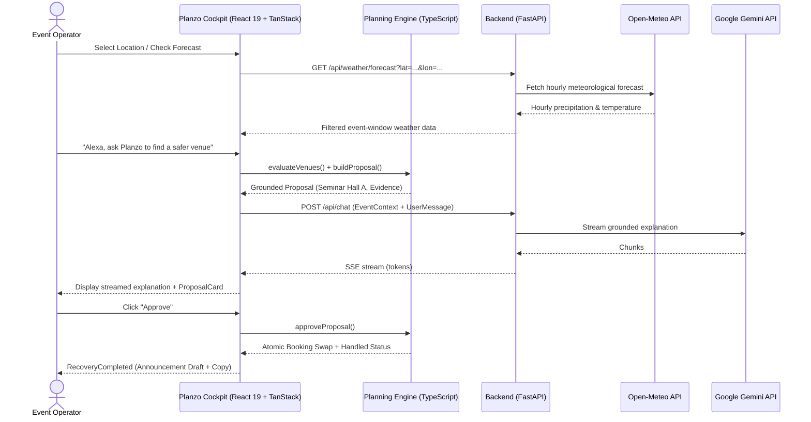

# Planzo — Intelligent Event Contingency & Recovery Assistant

## One-Line Pitch
Planzo pairs Google Gemini conversational intelligence with a deterministic planning engine to simulate an Alexa+ event operations assistant that evaluates meteorological disruptions, recommends grounded venue alternatives, and coordinates attendee communications upon human authorization.

---

## Problem
Event operations teams manage complex, high-stakes logistics under tight deadlines. When unexpected disruptions occur—such as an unpredicted rainstorm threatening an outdoor workshop—organizers face a chaotic scramble:
1. **Fragmented Room Information:** Identifying available backup spaces requires frantically cross-referencing campus booking calendars, room capacities, and A/V equipment lists.
2. **Hallucination Risk in Agentic AI:** Generic LLM agents cannot be trusted to autonomously execute facility relocations; an ungrounded model might promise a hall that is already booked, lacks required projectors, or is physically too small for the attendee count.
3. **Weather Uncertainty:** Planners struggle to bridge the gap between live meteorological forecasts and actionable operational decisions for specific event timeframes.
4. **Communication Bottlenecks:** Even after a decision is made, drafting clear, accurate notifications with updated building locations and unchanged timelines takes valuable time.

---

## Solution
Planzo resolves this challenge by strictly separating **conversational intelligence** from **deterministic execution**:
- **Dual-Mode Meteorological Intelligence:** Planners can assess threats using **Live Open-Meteo Forecasts** (fetching real-world hourly precipitation and wind probabilities for any city) or activate **Simulated Scenarios** to stress-test drills.
- **Grounded Conversational Interface (Alexa+ Simulation):** Organizers interact naturally through voice or text prompts (e.g. *"Alexa, ask Planzo what's happening with TechFest"*, *"Alexa, ask Planzo to find a safer venue"*).
- **Authoritative Deterministic Engine:** Rather than allowing the LLM to guess, Planzo's TypeScript planning engine computes physical feasibility: evaluating venue capacity ($\ge$ attendee count), indoor protection against rain, required A/V equipment presence, and booking conflicts across the event time window.
- **Human-in-the-Loop Safety Guardrail:** The AI is strictly advisory. Conversational attempts to execute bookings (e.g. *"Alexa, approve this change"*) are intercepted with safety guidance directing the user to review the proposal card and click an explicit authorization button.
- **Automated Post-Approval Recovery:** Upon human approval, Planzo updates reservations atomically and auto-generates a formatted attendee announcement ready for one-click clipboard copying.
- **Facility & Event Management:** Organizers can dynamically create, edit, and safely manage campus venues and multi-track schedules with built-in conflict prevention.

---

## Core Features

### 1. Operations Overview Dashboard
- High-level bird's-eye view of upcoming events, at-risk events, and suitable backup venues.
- Distinct status badges distinguishing **Forecast from Open-Meteo** from **Simulated scenario**.
- Priority alerts highlighting events requiring immediate operator intervention.

### 2. Disruption & Weather Intelligence (Dual-Mode)
- **Mode A (Simulated Scenario):** Configurable rain probabilities (0–100%), precipitation depth (mm), and wind speeds for offline contingency drills.
- **Mode B (Live Forecast via Open-Meteo):** Instant city geocoding and 16-day hourly meteorological forecasts filtered strictly to the event's scheduled window.
- Transparent attribution to [Open-Meteo.com](https://open-meteo.com/) with visible forecast timestamps.

### 3. Venue & Schedule Management
- Comprehensive campus facility inventory with indoor/outdoor classification, seat capacities, and audiovisual equipment tags.
- Interactive **Slot Availability Checker** for checking date/time conflicts before booking.
- Safe deletion guards preventing accidental deletion of facilities with confirmed reservations.

### 4. Alexa+ Experience Simulation Mode
- Emulates a multimodal smart display or ambient voice assistant within the Event Cockpit.
- Voice query normalization that automatically handles Alexa wake words and invocation phrasing.
- Real-time Server-Sent Events (SSE) token streaming powered by Google Gemini via FastAPI.
- Optional speech synthesis to read assistant responses aloud hands-free.

### 5. Deterministic Decision Studio
- Side-by-side before/after comparison table (venue setting, capacity, time window).
- "Why Recommended" rationale highlighting least-wasted capacity and weather protection.
- Transparent venue evidence explaining exactly why other venues were excluded (e.g., conflicting booking, missing equipment, insufficient seats).

### 6. Human-Authorized Action Safety
- Clear separation between advisory reasoning and operational execution.
- Conversational attempts to approve trigger safety guidance directing users to manual confirmation.

### 7. Post-Approval Recovery & Attendee Announcement Draft
- Immediate status transition to "Handled & verified" upon approval.
- Grounded announcement generator producing an accurate notification with event name, previous venue, new venue, unchanged schedule, and contingency context.
- Single-click clipboard copy with visual feedback toast.

### 8. Chronological Activity History
- Permanent audit trail logging all approved and rejected decisions, venue creations, and risk modifications with timestamps and explanations.

---

## Technical Architecture

- **Frontend:** React 19, TypeScript, TanStack Start, TanStack Router, Vite, Tailwind CSS, Lucide Icons, Sonner.
- **Backend:** Python 3.11, FastAPI, Uvicorn, Google GenAI SDK (`google-genai`), HTTPX, Pydantic v2.
- **Model:** Google Gemini (`gemini-3.5-flash-lite` / `gemini-3.8-flash`) via streaming SSE.
- **Data Architecture:** Authoritative typed seed state in `localStorage` with instant reset capability.

---

## Alexa+ Simulation Explanation
Planzo entered the **Alexa+ Simulated Experience** track to explore how next-generation, agentic ambient assistants can assist operations managers. Instead of rigid slot-filling skills, Planzo illustrates how an agentic assistant can:
1. Ground conversational answers in live application state and real weather forecasts.
2. Formulate multi-step recovery proposals with explicit rationale.
3. Gracefully refuse unsafe autonomous actions and guide the human operator to authorize decisions.

---

## Innovation & Impact
- **Zero-Hallucination Operations:** By offloading room constraints, capacities, and scheduling logic to deterministic algorithms, the LLM is restricted to explanation and synthesis—eliminating catastrophic scheduling errors.
- **Human-in-the-Loop Governance:** Combines the speed of AI recommendations with human oversight for physical asset allocation.
- **Instant Recovery Time:** Reduces contingency decision-making and attendee communication drafting from 30+ minutes of manual coordination to under 30 seconds.

---

## What's Next
- **Production Alexa Skill Deployment:** Implementing an Alexa Presentation Language (APL) interface for physical Echo Show and smart display devices.
- **Multi-Tenant Calendar Integrations:** Live sync with Google Workspace Calendar, Microsoft 365, and campus room scheduling systems (e.g. EMS).
- **Multi-Channel Notification Dispatch:** Direct integration with Twilio SMS, Slack webhooks, and email listservs for instant one-click broadcasting upon approval.
